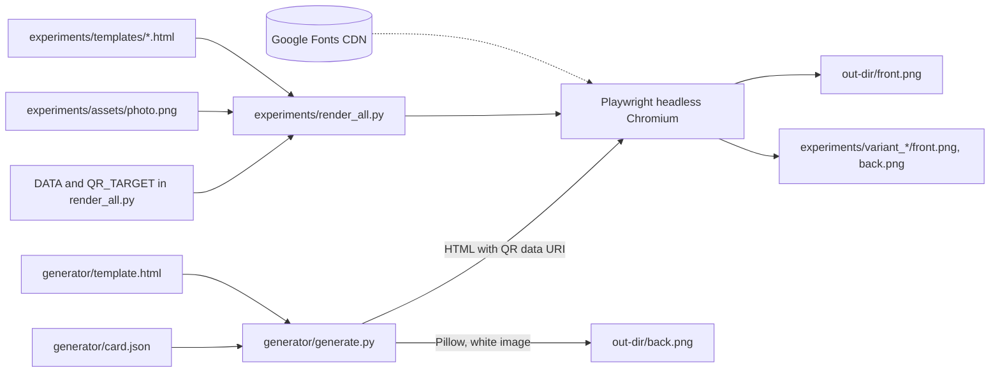

# visitka - documentation hub

"Visitka" is Russian for "business card" (`README.md:3`). The repository holds
one person's business card: the current card images (`front.png`, `back.png`),
a Python script that renders those images from a JSON config (`generator/`),
eleven alternative card designs and the script that renders them
(`experiments/`), two vCard contact files (`experiments/vcf/`), HTML pages for
printing cards at 90 x 50 mm, and a one-page CV in HTML and PDF. No file names
an audience other than the card's owner; see [Open questions](../SPEC.md#9-open-questions).

The requirements reverse-engineered from the code are in [SPEC.md](../SPEC.md).

## 1. Status

| Item | State | Source |
| --- | --- | --- |
| Documented commit | `0e235cf`, 2026-11-08, merge of PR #18 into `release` | `git log -1` |
| Last change to the Python scripts | 2026-07-07 (`bbb6840` for `generate.py`, `6c285d8` for `render_all.py`) | `git log -- generator/generate.py experiments/render_all.py` |
| Last change to card, CV or contact content | 2026-08-07, `de6d49a` (address in the CV reduced to the city) | `git log` |
| Last change touching those files at all | 2026-11-07, `54a34a7`: images and PDFs moved to Git LFS; no text content file changed | `git show --stat 54a34a7` |
| Tests for the project's own code | None. `pytest --collect-only` over `.claude` collects nothing (exit 5) | run 2026-11-18 |
| CI | `.gitea/workflows/test.yaml` runs `.\recipe.ps1 test` (line 56), which lints and tests `.claude` only, not `generator/` or `experiments/` | `recipe.ps1:45-53` |
| Evidently unfinished | `cv.html` points at an `image.png` that is not committed (`cv.html:46`, `README.md:25-26`); the variant 11 claim "5+ years experience" is marked unverified (`experiments/README.md:260-263`) | as cited |

## 2. Layout

| Path | What it is |
| --- | --- |
| `front.png`, `back.png` | Current card, 1119 x 615 px each. `front.png` was regenerated by the generator in `bbb6840`; `back.png` is plain white |
| `generator/generate.py` | CLI that renders `front.png` and `back.png` from a JSON config |
| `generator/template.html` | Jinja2 template of the generator's card (QR panel left, text panel right) |
| `generator/card.json` | The content config used for the current card |
| `generator/requirements.txt` | Dependency ranges for both Python scripts |
| `experiments/render_all.py` | Renders the front and back of all eleven design variants |
| `experiments/templates/` | 11 front templates, a shared back template for variants 1-10, a back template for variant 11 |
| `experiments/variant_*/` | Rendered `front.png` / `back.png` per variant; `variant_06_qr_centerpiece/previews/` holds five label placements |
| `experiments/assets/` | `photo.png` (560 x 560, used by the variants) and `photo_old.png` (640 x 640, kept) |
| `experiments/vcf/` | `vcf_standard.vcf` (official contact file), `vcf_minimal.vcf` (fallback), a README |
| `print.html`, `print_many.html`, `print.css` | Russian-language print pages: one card, or 12 cards per A4 landscape sheet |
| `QR code VCF.jpg`, `webpage qr code.png` | QR images used on the back of the print pages |
| `Печать многих визиток - Igors Volohovs.pdf` | PDF printed from `print_many.html` (`README.md:22-24`) |
| `cv.html`, `CV_Igors_Volohovs_OnePage.pdf` | One-page CV; nothing in the repository builds the PDF from the HTML (commit `de6d49a` message) |
| `me.png` | Portrait, 2560 x 2560 px |

## 3. Architecture

Two independent render pipelines share the same technique: fill a Jinja2 HTML
template, embed a QR code as a base64 PNG data URI, load the HTML into headless
Chromium through Playwright, and screenshot the element `#card`
(`generator/generate.py:64-99`, `experiments/render_all.py:41-48,147-184`).
The print pages and the CV are static HTML opened in a browser; no script
produces or consumes them.



External services: the templates load fonts from `fonts.googleapis.com`
(`generator/template.html:5-6`, `experiments/render_all.py:68-76`). The print
pages and the CV load Font Awesome 6.4.0 from cdnjs (`print.html:6`,
`cv.html:8`) and the Inter font from `fonts.googleapis.com` (`print.html:9`,
`print_many.html:9`, `cv.html:10`); the CV also loads the Tailwind CDN script
(`cv.html:6`) and carries an inlined Tailwind v3.4.17 stylesheet (`cv.html:36`).

## 4. Build and run

Prerequisites, from `generator/README.md:21-26` and `generator/requirements.txt:1-4`:
Python 3.12 (the README creates the venv with `py -3.12`), `jinja2>=3.1,<4`,
`qrcode>=8.0,<9`, `pillow>=10.0,<12`, `playwright>=1.45,<2`, and Playwright's
Chromium. There is no lock file.

```powershell
# generator/README.md:22-25, run inside generator/
py -3.12 -m venv .venv
.\.venv\Scripts\Activate.ps1
pip install -r requirements.txt
playwright install chromium

# generator/README.md:31 and generator/generate.py:11
python generate.py --config card.json --out-dir output/
```

The second pipeline (`experiments/README.md:101-103`), run inside
`experiments/` with the generator's venv or another one with the same
requirements:

```powershell
python render_all.py
```

`render_all.py` overwrites the 22 tracked `experiments/variant_*/front.png` and
`back.png` files (`experiments/render_all.py:159-181`).

Print pages: open `print.html` or `print_many.html` in a browser and print; the
on-page note (in Russian) asks to enable background graphics and, for
`print_many.html`, landscape orientation (`print.html:15-17`,
`print_many.html:53-55`).

## 5. Configuration

`generator/generate.py` reads no environment variables. Its inputs are two
command-line options and one JSON file.

| Name | Kind | Meaning | Default | Source |
| --- | --- | --- | --- | --- |
| `--config` | CLI option, required | Path to the JSON content config | none | `generate.py:108` |
| `--out-dir` | CLI option, required | Directory for `front.png` and `back.png`; created if missing | none | `generate.py:109,113-114` |
| `name`, `title`, `phone`, `email`, `url` | JSON keys, required | Text printed on the card; a missing key raises `KeyError` | none | `generate.py:80-84` |
| `qr_data` | JSON key, required | Payload encoded in the QR code; kept separate from `url` on purpose | none | `generate.py:86`, `generator/README.md:53-65` |
| `tags` | JSON key, optional | List of tag strings, any length | `[]` | `generate.py:85` |

Colours, fonts, sizes, panel proportion and QR parameters are not configurable:
they are the `DESIGN` dict and the `QR_*` constants in `generate.py:32-61`.

`experiments/render_all.py` takes no arguments. Its content is hard-coded in
`DATA`, `QR_TARGET`, `QR_CAPTION`, `FRONT_VARIANTS` and `BACK_STYLES`
(`render_all.py:26-144`); it does not read `generator/card.json`.

## 6. Usage

- Render the current card into a scratch folder and compare it with the
  committed one: `python generate.py --config card.json --out-dir output/`
  (inside `generator/`; `output/` is ignored by `generator/.gitignore:2`).
- Make a card with different content: copy `card.json`, change the values, point
  `--config` at the copy. The layout stays the same (`generator/README.md:71-74`).
- Regenerate all design variants after editing a template: `python render_all.py`
  inside `experiments/`, then review `git status` for the changed PNGs.
- Send contact details: `experiments/vcf/vcf_standard.vcf` is named the official
  contact file (`experiments/vcf/README.md:24-27`).

## 7. Testing

There are no tests for `generator/` or `experiments/`. `.\recipe.ps1 test`
sets `core.hooksPath`, then runs `pytest`, `ruff check` and `ruff format` over
`.claude` only (`recipe.ps1:41-54`); pytest exit code 5 (nothing collected) is
accepted (`recipe.ps1:47-48`, `.claude/pytest.ini:2`). Visual checks that the
documents describe (SSIM against the original artwork, QR decoding with OpenCV)
were one-off and their scripts are not in the repository
(`generator/README.md:78-81`, `experiments/README.md:69-70`).

## 8. Known limitations and problems

- `generator/template.html:17-18` uses `tag_bg` and `tag_text`, which `DESIGN`
  does not define; Jinja2 renders them empty (`--tag-bg: ;`, checked by
  rendering the template in memory on 2026-11-18). No CSS rule reads those
  variables, so the output is not affected.
- `generator/README.md:78` measures accuracy against `../front.png` as "the
  original card image", but `bbb6840` replaced the root `front.png` with
  generator output after enlarging the text about 20 %. The table describes the
  state before that commit; the original artwork is in `d64cadd`.
- `experiments/vcf/README.md:34` says the vCards have CRLF line endings. The
  committed files are LF in the index and in the working tree
  (`git ls-files --eol`), and `.gitattributes:1` (`* text=auto eol=lf`) checks
  them out as LF; no commit since `84e7ba3` has held them with CRLF. The line
  folding is within 75 characters (measured).
- Content differs between files: the print pages and the CV title the owner
  "C/C++ and Computer Vision Developer" / "C/C++ Developer"
  (`print.html:26`, `cv.html:158`), the card says "Software Engineer"
  (`generator/card.json:3`). `card.json:8` keeps the "AI Intergation" typo on
  purpose (`generator/README.md:66-69`); `render_all.py:31` spells it correctly.
  The phone string is formatted differently in `card.json:4` and
  `render_all.py:29`.
- Rendering loads web fonts and waits for network idle
  (`generate.py:96`, `render_all.py:161`). Inference: offline, Chromium falls
  back to the next font in the stack (`template.html:28`: Arial), so the output
  will not match the committed images.
- Images and PDFs are Git LFS objects (`.gitattributes:8-10`). Inference from
  `54a34a7`, where they became 129-132 byte pointers: a clone without Git LFS
  gets pointer files, and `render_all.py:149` would embed a pointer instead of
  `photo.png`.
- `print.css:114` uses `var(--white)`, which `print.css` does not define.
- `README.md:33-34` says verbs other than `test` and `info` print
  `nothing to <verb>`; `clean` deletes `__pycache__`, `.pytest_cache` and
  `.ruff_cache` folders (`recipe.ps1:63-68`).
- The Jinja2 environments are created without autoescaping
  (`generate.py:76`, `render_all.py:148`); config text is inserted into HTML
  as is.

## 9. Repository tooling

The repository carries the lab tooling of
[repo-quality-template](https://github.com/IGORSVOLOHOVS/repo-quality-template)
(`recipe.ps1`, `.claude/hooks/`, `.claude/settings.json`,
`.claude/skills/lab-ai-env`, `.gitea/`). `README.md:42` states compliance with
revision 4.0.0 of the lab requirements, except R-02, R-09, R-37, R-41 and R-42.
What is specific here:

- `recipe.ps1:9-17`: `$Name = 'visitka'`, `$Code = 'vis'`, `$Version = '1.0.0'`;
  `$Needs`, `$Tools` and `$Provides` are empty and there is no `$App`
  ("nothing is installed").
- Verbs that act: `test` (pytest and ruff over `.claude` only), `info` (prints
  name, code, version, summary; run on 2026-11-18, exit 0), `clean` (removes
  cache folders). `build`, `install`, `uninstall`, `run`, `publish` print
  `nothing to <verb>` (`recipe.ps1:69-73`).
- Deviations the repository declares: `.claude/.env` is gitignored and never
  committed (`CLAUDE.md` rule 4, `.gitignore:20-24`); pre-lab history kept as
  is (R-09, `CLAUDE.md`); `$Reviewers` is one name. `.claude/pytest.ini` and
  `.claude/ruff.toml` (ruff `==0.16.1`) exist here and not in the template.
  The template's `CHANGELOG.md`, `CONTRIBUTING.md`, `SECURITY.md`,
  `CODE_OF_CONDUCT.md`, `.pre-commit-config.yaml`, `scripts/` and
  `tools/wiki.py` are absent.

## 10. Related documents

- [README.md](../README.md) - repository overview
- [SPEC.md](../SPEC.md) - requirements specification
- [generator/README.md](../generator/README.md) - generator setup, config schema, accuracy notes
- [experiments/README.md](../experiments/README.md) - the eleven variants, photo, QR print-size check
- [experiments/vcf/README.md](../experiments/vcf/README.md) - vCard files and why they replaced the old one
- [CLAUDE.md](../CLAUDE.md) - working rules for this repository
- [LICENSE](../LICENSE) - MIT

## 11. About this document

Written 2026-11-18 from commit `0e235cf` (branch `docs/spec-and-docs`, from
`origin/release`). Every statement cites the file or command it comes from.

Commands run: `git ls-files`, `git log` (with paths and `--stat`),
`git show` of `bbb6840`, `de6d49a`, `7a0aa02`, `54a34a7`,
`git ls-files --eol`, `.\recipe.ps1 info`,
`python -m pytest --collect-only -q -p no:cacheprovider .claude`,
an in-memory Jinja2 render of `generator/template.html`, PNG header reads for
image sizes, and `python generator/generate.py --help` (failed with
`ModuleNotFoundError: qrcode`: the requirements are not installed on the
documenting machine).

Not run: `generate.py` and `render_all.py` (no venv, no Chromium for
Playwright, and `render_all.py` overwrites tracked files), `.\recipe.ps1 test`
(it writes `core.hooksPath` and formats files in place; ruff is not installed
here), the print pages, decoding of any QR code (OpenCV is not installed), and
importing the vCards on a phone.
